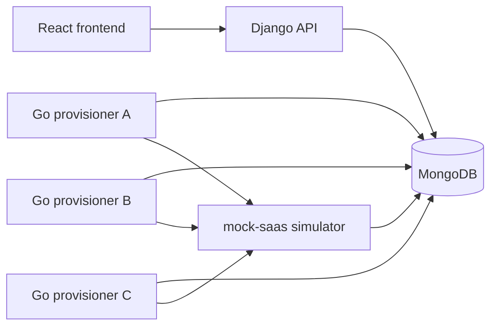

# LaunchOps

LaunchOps is a local onboarding workflow system for HR, IT, managers and employees. A Django + MongoDB API owns workflow rules, evidence forms, prerequisites, issues and final sign-off. A Go provisioner creates a new hire's accounts in external systems, simulated here by `mock-saas`. React, TypeScript and Vite provide the role-specific interface. Public registration is unavailable.

The project explores concurrent updates and recovery from ambiguous external side effects. [DESIGN.md](docs/DESIGN.md) explains the choices and limitations; the [spec](docs/V2_SPEC.md) defines the behavior.

## Architecture



Compose runs three provisioner replicas, matching the recorded [campaign configuration](docs/evidence/chaos/campaign-1/config.json). Django owns business state; workers own job transitions. The simulator uses its own database on the same MongoDB service.

## Quick start

Install Docker with Compose, then run from the repository root:

```bash
docker compose -p launchops-v2 up --build
```

In another terminal, seed the local demo:

```bash
docker compose -p launchops-v2 exec backend python manage.py seed_launchops
```

The command inside the backend container is `python manage.py seed_launchops`. Seeding requires `DEBUG=True`, which is the Compose default. Open the frontend at `http://localhost:13000`; the API is at `http://localhost:18000/api` (default ports are defined in [Compose](docker-compose.yml); override them with `FRONTEND_PORT`, `BACKEND_PORT`, `MONGO_PORT` and `MOCKSAAS_PORT`; if you change `FRONTEND_PORT`, also set `CORS_ALLOWED_ORIGINS` to the new frontend origin). `GET /healthz` is unauthenticated and checks MongoDB; it returns `{"status":"ok"}` when available and an unavailable status when the ping fails.

| Role | Username |
|---|---|
| HR | `demo_hr` |
| IT | `demo_it` |
| Manager | `demo_manager` |
| Employee | `demo_employee` |

All demo accounts use the password `LaunchOpsDemo2026!`, defined by the [seed command](backend/onboarding/management/commands/seed_launchops.py). The seeded workflow lets each role inspect its tasks. Forms record local simulations and self-reported evidence. Preserve Docker volumes.

## Tests

With MongoDB and the backend running:

```bash
docker compose -p launchops-v2 exec backend python manage.py test --noinput
```

For Go, install the version declared in [go.mod](provisioner/go.mod), then run against the Compose MongoDB port:

```bash
cd provisioner
go vet ./...
MONGO_URI=mongodb://localhost:27017 go test -race -count=1 ./...
```

Go's integration tests use real MongoDB. Keep `MONGO_URI` set so they execute. For the frontend, use the Node version configured in [CI](.github/workflows/ci.yml):

```bash
cd frontend
npm ci
npm run typecheck
npm test
npm run build
```

CI runs Django, Go and frontend checks as separate jobs. The Go job uses a MongoDB service and the module's Go version. Chaos campaigns are separate from CI.

## Concurrency design

Each hire is an aggregate document with embedded steps, issues, events and provisioning jobs.  
Django reads a snapshot and validates the requested business mutation.  
Its conditional update matches the document's `version` and advances that version.  
Step completion also requires `steps: {$elemMatch: {key, status: "open"}}`.  
`arrayFilters` selects the element to change; it cannot guard the document-level event append.  
The same write stores the completion, event and any issue or final workflow state.  
A lost compare-and-set rebuilds the decision against a fresh snapshot.  
When every competing writer advances `version`, either completion guard alone prevents duplicate completion; the step guard also rejects a write that does not advance `version` or whose array filter matches no element. Both are retained.  
`Idempotency-Key` is stored with the completion, and replays return the original completion without another event.  
Permissions are checked before replay; event array order defines history.

See [concurrency tests](backend/onboarding/test_concurrency.py): `test_twenty_threads_one_step_complete_once_with_identical_responses`, `test_version_guard_alone_gives_exactly_once`, `test_step_element_guard_alone_gives_exactly_once`, and `test_negative_control_without_guards_duplicates_are_detected`. These are test references, not a separate concurrency evidence run.

## Provisioning design

Pending job state is embedded in the workflow insert and acts as the durable queue.  
Polling workers claim due jobs with compare-and-set on connector, status, fence and due condition.  
A lease lets another worker reclaim work after a crash or stall.  
Every claim advances the fence; stale workers cannot finish a newer claim.  
Attempts count the current retry round; IT manual retry resets attempts while preserving the fence.  
Workers update their job element and append provisioning events without changing the business version.  
Transient responses and transport failures retry with capped exponential backoff and full jitter.  
Permanent errors or exhausted attempts leave a dead job; if its external account already exists, IT reconciles it with a manual retry first and a verified override as the fallback.  
The external idempotency key stays constant across attempts and replays the stored simulator response.  
After drop-after-commit, a retry can recover an account that exists even though the caller received no response.

## Results

Evidence is local to the recorded environments, with commands and raw output retained. [Provisioner evidence](docs/evidence/provisioner/) and [orphaned-key recovery evidence](docs/evidence/provisioner/c12/) include passing output and targeted guard-removal experiments. The [job-store guard report](docs/evidence/provisioner/guard-removal-results.md) and [simulator guard report](docs/evidence/provisioner/c12-guard-removal.md) name the failures caused by each removal. No throughput or production-readiness claim follows from them.

The earlier [run-1 result](docs/evidence/chaos/run-1/verify.json) records `invariants_passed: true` but `passed: false`: fence rejections were not exercised. The later campaigns recorded the following per-run results, copied directly from their verifier outputs:

| Evidence | jobs | statuses | accounts | fence_rejections | kills | pauses | replays | drops |
|---|---:|---|---:|---:|---:|---:|---:|---:|
| [campaign-1](docs/evidence/chaos/campaign-1/verify.json) | 363 | `{"succeeded": 359, "dead": 4}` | 360 | 9 | 38 | 26 | 74 | 34 |
| [campaign-2](docs/evidence/chaos/campaign-2/verify.json) | 363 | `{"succeeded": 362, "dead": 1}` | 363 | 10 | 27 | 19 | 72 | 37 |
| [campaign-3](docs/evidence/chaos/campaign-3/verify.json) | 363 | `{"succeeded": 361, "dead": 2}` | 363 | 4 | 34 | 23 | 76 | 43 |

Each campaign's configuration is recorded independently:

| Configuration | hires | replicas | kill interval (s) | pause interval (s) | pause duration (s) | error_rate | hang_rate | drop_rate | latency (ms) |
|---|---:|---:|---:|---:|---:|---:|---:|---:|---:|
| [campaign-1](docs/evidence/chaos/campaign-1/config.json) | 120 | 3 | 10.0 | 15.0 | 35.0 | 0.2 | 0.05 | 0.1 | 3000 |
| [campaign-2](docs/evidence/chaos/campaign-2/config.json) | 120 | 3 | 10.0 | 15.0 | 35.0 | 0.2 | 0.05 | 0.1 | 3000 |
| [campaign-3](docs/evidence/chaos/campaign-3/config.json) | 120 | 3 | 10.0 | 15.0 | 35.0 | 0.2 | 0.05 | 0.1 | 3000 |

The snapshots include the seeded demo workflow as well as campaign hires, as described in the [campaign guide](docs/evidence/chaos/README.md). `passed: true` includes explicit reporting of `dead_with_accounts`; it does not mean every job succeeded. Known dead jobs whose account already exists, which IT resolves by reconciliation (a manual retry first, since the same idempotency key makes the simulator replay the stored response, then a verified override as the fallback), are `workspace / chaos-employee-0086` in [campaign-1](docs/evidence/chaos/campaign-1/verify.json), `slack / chaos-employee-0092` in [campaign-2](docs/evidence/chaos/campaign-2/verify.json), and `github / chaos-employee-0082` plus `slack / chaos-employee-0096` in [campaign-3](docs/evidence/chaos/campaign-3/verify.json). The verifier checks account references and terminal states and reports these ambiguous side effects; it does not establish availability or behavior under host or database loss.

## Boundaries

local demo; simulated accounts, payroll, identity and devices; external systems are a local mock with injected faults; single host;
no production, HA or failover claim; the browser walkthrough is a local Playwright script and is not part of CI.

## Origins

LaunchOps started as a learning-management system I built (courses, chapters, quizzes, scheduling, course chat history) and that I converted into this onboarding platform. The onboarding workflow engine was later work in this repository. The learning modules were removed when the onboarding backend moved to MongoDB; the earlier PostgreSQL version is preserved at the tag `v1-postgres`. This repository's history starts from a snapshot of the combined code, so it does not show that split.

## AI tools used

I built this project with help from AI tools, including GitHub Copilot, Cursor, Claude Code and Codex. I directed the design and reviewed the changes. I ran the test suites and the chaos campaigns myself. The raw outputs are committed under [docs/evidence](docs/evidence/).
